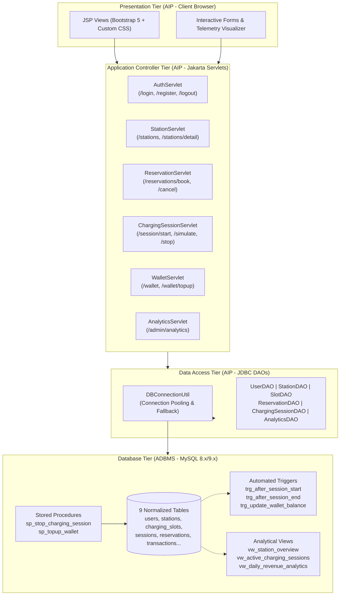
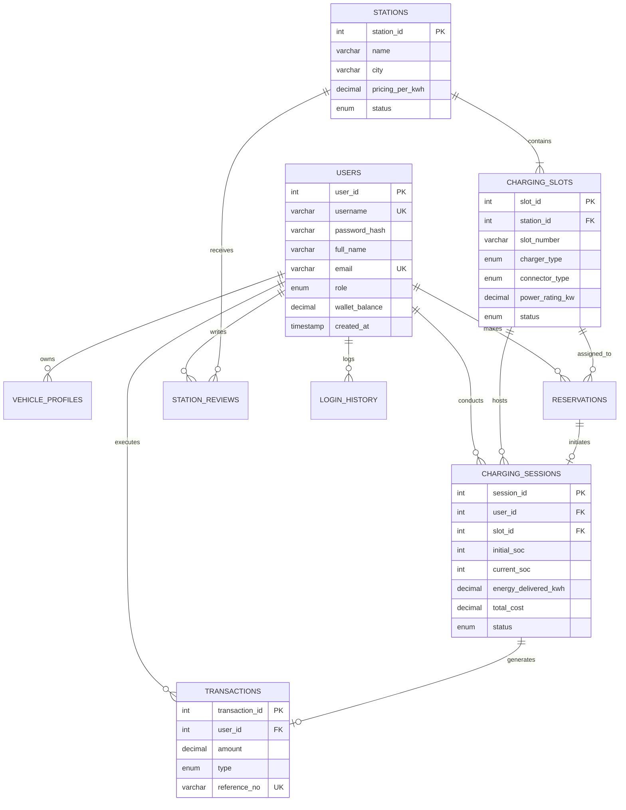
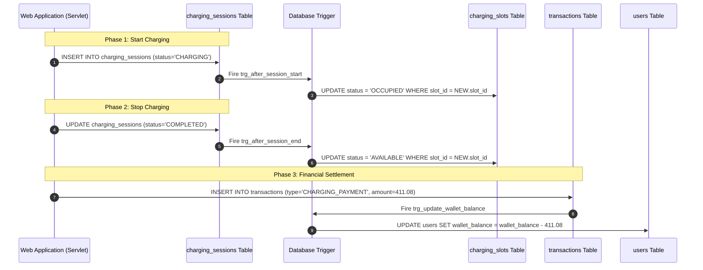
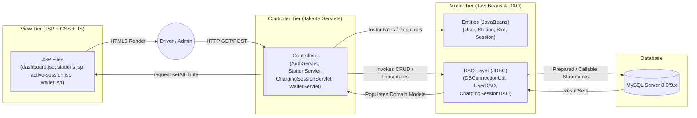

# EVChargeDB: Advanced Database Management System for Electric Vehicle Charging Station Management
## Integrated Comprehensive Project Report & Academic Case Study

---

| **Project Title** | EVChargeDB: Electric Vehicle Charging Station Management System |
|---|---|
| **Subjects Covered** | **ADBMS** (Advanced Database Management Systems) &amp; **AIP** (Advanced Internet Programming) |
| **Backend Architecture** | Jakarta Servlets (Servlet 6.0), JDBC API, Apache Tomcat 11 |
| **Database Tier** | MySQL Community Server 8.0/9.x (InnoDB Engine, UTF-8 Unicode) |
| **Frontend Tier** | JavaServer Pages (JSP 3.1), JSTL 3.0, CSS3 Cyberpunk-Emerald UI |
| **Development Environment** | Eclipse IDE for Enterprise Java and Web Developers, Java SE 21 |

---

## Executive Summary & Abstract

With the global transition toward electric mobility, charging infrastructure operators face complex data-management and concurrency challenges: handling real-time telemetry, managing charging bay reservations, preventing double-booking, tracking dynamic per-kWh tariffs, maintaining auditable digital wallets, and generating multi-dimensional business reports.

**EVChargeDB** is an enterprise-grade, joint academic capstone project engineered to address these challenges. The system is split cleanly into two core pillars:
1. **The ADBMS Pillar**: Focuses on rigorous relational modeling normalized up to Boyce-Codd Normal Form (BCNF), event-driven database triggers for automated slot lifecycle management, stored procedures encapsulating atomic financial computations, multi-table analytical views, and ACID transaction safety with composite indexing.
2. **The AIP Pillar**: Implements the Model-View-Controller (MVC) architectural pattern using Jakarta Servlets as controllers, pure JDBC Data Access Objects (DAOs) executing parameterized and callable queries, secure `HttpSession` tracking with Role-Based Access Control (Admin, Operator, Driver), and dynamic JSP presentation rendered with the Jakarta Standard Tag Library (JSTL 3.0).

---



---

# PART I: ADBMS (ADVANCED DATABASE MANAGEMENT SYSTEMS) CASE STUDY

---

## 1. Domain Analysis & Schema Architecture

EV charging infrastructure requires low-latency transaction processing coupled with consistency guarantees. In EVChargeDB, the relational structure models physical charging hardware, driver accounts, vehicles, scheduled reservations, live charging telemetry, and digital billing.



---

## 2. Normalization Analysis (1NF &rarr; 2NF &rarr; 3NF &rarr; BCNF)

To ensure zero update anomalies, insertion anomalies, and deletion anomalies, the EVChargeDB schema is designed through formal normalization:

### 2.1 First Normal Form (1NF)
* **Criterion**: All attributes contain atomic values; each column has a defined type, and there are no repeating groups.
* **Implementation**: Connector types, vehicle license plates, user contact information, and coordinates are split into discrete atomic fields (`latitude`, `longitude`, `connector_type`, `phone`).

### 2.2 Second Normal Form (2NF)
* **Criterion**: Must be in 1NF and contain no partial dependencies (no non-prime attribute may depend on a proper subset of any candidate key).
* **Implementation**: In composite relationships (such as a station having multiple slots), each slot is assigned a unique surrogate primary key `slot_id`. Candidate key `(station_id, slot_number)` uniquely identifies a bay, but station pricing and address depend strictly on `station_id`, preventing duplicate station attributes across slot records.

### 2.3 Third Normal Form (3NF)
* **Criterion**: Must be in 2NF and contain no transitive dependencies ($X \to Y$ and $Y \to Z$ where $Z$ is non-prime).
* **Implementation**: In early unnormalized designs, vehicle battery capacity might be stored directly in `charging_sessions`. In EVChargeDB, vehicle telemetry depends on `vehicle_profiles`, station tariffs depend on `stations`, and user credentials depend on `users`. Every non-key column depends solely on the primary key ($X \to A$ where $X$ is a superkey).

### 2.4 Boyce-Codd Normal Form (BCNF)
* **Criterion**: For every functional dependency $X \to Y$, $X$ must be a superkey.
* **Verification**: In `charging_slots`, the candidate keys are `slot_id` and `(station_id, slot_number)`. Every functional determinant is a superkey:
  $$\text{slot\_id} \to \{\text{station\_id}, \text{slot\_number}, \text{charger\_type}, \text{power\_rating\_kw}, \text{status}\}$$
  $$\{\text{station\_id}, \text{slot\_number}\} \to \{\text{slot\_id}, \text{charger\_type}, \text{power\_rating\_kw}, \text{status}\}$$
  No non-superkey determinants exist, satisfying BCNF.

---

## 3. Relational Schema DDL & Integrity Constraints

The complete database schema is implemented with foreign key constraints, `ON DELETE CASCADE` rules, composite unique indexes, and `CHECK` validation:

```sql
-- Database Instantiation
DROP DATABASE IF EXISTS evcharge_db;
CREATE DATABASE evcharge_db CHARACTER SET utf8mb4 COLLATE utf8mb4_unicode_ci;
USE evcharge_db;

-- 1. USERS TABLE
CREATE TABLE users (
    user_id INT AUTO_INCREMENT PRIMARY KEY,
    username VARCHAR(50) NOT NULL UNIQUE,
    password_hash VARCHAR(255) NOT NULL,
    full_name VARCHAR(100) NOT NULL,
    email VARCHAR(100) NOT NULL UNIQUE,
    phone VARCHAR(20),
    role ENUM('ADMIN', 'OPERATOR', 'DRIVER') NOT NULL DEFAULT 'DRIVER',
    wallet_balance DECIMAL(10,2) NOT NULL DEFAULT 500.00,
    created_at TIMESTAMP DEFAULT CURRENT_TIMESTAMP
) ENGINE=InnoDB;

-- 2. CHARGING STATIONS TABLE
CREATE TABLE stations (
    station_id INT AUTO_INCREMENT PRIMARY KEY,
    name VARCHAR(100) NOT NULL,
    address VARCHAR(255) NOT NULL,
    city VARCHAR(50) NOT NULL,
    state VARCHAR(50) NOT NULL,
    zip_code VARCHAR(20) NOT NULL,
    latitude DECIMAL(10,8) NOT NULL,
    longitude DECIMAL(11,8) NOT NULL,
    operating_hours VARCHAR(50) NOT NULL DEFAULT '24/7',
    pricing_per_kwh DECIMAL(6,2) NOT NULL DEFAULT 12.50,
    status ENUM('ACTIVE', 'INACTIVE', 'MAINTENANCE') NOT NULL DEFAULT 'ACTIVE',
    created_at TIMESTAMP DEFAULT CURRENT_TIMESTAMP,
    INDEX idx_city_status (city, status)
) ENGINE=InnoDB;

-- 3. CHARGING SLOTS TABLE
CREATE TABLE charging_slots (
    slot_id INT AUTO_INCREMENT PRIMARY KEY,
    station_id INT NOT NULL,
    slot_number VARCHAR(20) NOT NULL,
    charger_type ENUM('AC_LEVEL_2', 'DC_FAST', 'ULTRA_FAST') NOT NULL DEFAULT 'DC_FAST',
    connector_type ENUM('CCS2', 'CHAdeMO', 'TYPE_2', 'GB_T') NOT NULL DEFAULT 'CCS2',
    power_rating_kw DECIMAL(5,1) NOT NULL DEFAULT 50.0,
    status ENUM('AVAILABLE', 'OCCUPIED', 'RESERVED', 'OUT_OF_SERVICE') NOT NULL DEFAULT 'AVAILABLE',
    FOREIGN KEY (station_id) REFERENCES stations(station_id) ON DELETE CASCADE,
    UNIQUE KEY uk_station_slot (station_id, slot_number),
    INDEX idx_station_status (station_id, status)
) ENGINE=InnoDB;

-- 4. VEHICLE PROFILES TABLE
CREATE TABLE vehicle_profiles (
    vehicle_id INT AUTO_INCREMENT PRIMARY KEY,
    user_id INT NOT NULL,
    make VARCHAR(50) NOT NULL,
    model VARCHAR(50) NOT NULL,
    license_plate VARCHAR(20) NOT NULL UNIQUE,
    battery_capacity_kwh DECIMAL(5,1) NOT NULL,
    connector_type ENUM('CCS2', 'CHAdeMO', 'TYPE_2', 'GB_T') NOT NULL DEFAULT 'CCS2',
    created_at TIMESTAMP DEFAULT CURRENT_TIMESTAMP,
    FOREIGN KEY (user_id) REFERENCES users(user_id) ON DELETE CASCADE
) ENGINE=InnoDB;

-- 5. RESERVATIONS TABLE
CREATE TABLE reservations (
    reservation_id INT AUTO_INCREMENT PRIMARY KEY,
    user_id INT NOT NULL,
    slot_id INT NOT NULL,
    reservation_time DATETIME NOT NULL,
    duration_minutes INT NOT NULL DEFAULT 60,
    status ENUM('CONFIRMED', 'IN_PROGRESS', 'COMPLETED', 'CANCELLED', 'EXPIRED') NOT NULL DEFAULT 'CONFIRMED',
    booking_fee DECIMAL(8,2) NOT NULL DEFAULT 50.00,
    created_at TIMESTAMP DEFAULT CURRENT_TIMESTAMP,
    FOREIGN KEY (user_id) REFERENCES users(user_id) ON DELETE CASCADE,
    FOREIGN KEY (slot_id) REFERENCES charging_slots(slot_id) ON DELETE CASCADE,
    INDEX idx_user_res (user_id, status)
) ENGINE=InnoDB;

-- 6. CHARGING SESSIONS TABLE
CREATE TABLE charging_sessions (
    session_id INT AUTO_INCREMENT PRIMARY KEY,
    reservation_id INT NULL,
    user_id INT NOT NULL,
    slot_id INT NOT NULL,
    start_time DATETIME NOT NULL DEFAULT CURRENT_TIMESTAMP,
    end_time DATETIME NULL,
    initial_soc INT NOT NULL DEFAULT 20,
    current_soc INT NOT NULL DEFAULT 20,
    target_soc INT NOT NULL DEFAULT 85,
    energy_delivered_kwh DECIMAL(8,2) NOT NULL DEFAULT 0.00,
    rate_per_kwh DECIMAL(6,2) NOT NULL DEFAULT 12.50,
    total_cost DECIMAL(10,2) NOT NULL DEFAULT 0.00,
    status ENUM('CHARGING', 'COMPLETED', 'TERMINATED') NOT NULL DEFAULT 'CHARGING',
    created_at TIMESTAMP DEFAULT CURRENT_TIMESTAMP,
    FOREIGN KEY (user_id) REFERENCES users(user_id) ON DELETE CASCADE,
    FOREIGN KEY (slot_id) REFERENCES charging_slots(slot_id) ON DELETE CASCADE,
    FOREIGN KEY (reservation_id) REFERENCES reservations(reservation_id) ON DELETE SET NULL,
    INDEX idx_user_session (user_id, status)
) ENGINE=InnoDB;

-- 7. TRANSACTIONS TABLE
CREATE TABLE transactions (
    transaction_id INT AUTO_INCREMENT PRIMARY KEY,
    user_id INT NOT NULL,
    session_id INT NULL,
    amount DECIMAL(10,2) NOT NULL,
    type ENUM('WALLET_TOPUP', 'CHARGING_PAYMENT', 'RESERVATION_FEE', 'REFUND') NOT NULL,
    payment_method ENUM('WALLET', 'CREDIT_CARD', 'DEBIT_CARD', 'UPI', 'NET_BANKING') NOT NULL DEFAULT 'WALLET',
    status ENUM('SUCCESS', 'PENDING', 'FAILED') NOT NULL DEFAULT 'SUCCESS',
    reference_no VARCHAR(64) NOT NULL UNIQUE,
    created_at TIMESTAMP DEFAULT CURRENT_TIMESTAMP,
    FOREIGN KEY (user_id) REFERENCES users(user_id) ON DELETE CASCADE,
    FOREIGN KEY (session_id) REFERENCES charging_sessions(session_id) ON DELETE SET NULL,
    INDEX idx_user_trans (user_id, created_at)
) ENGINE=InnoDB;

-- 8. STATION REVIEWS TABLE
CREATE TABLE station_reviews (
    review_id INT AUTO_INCREMENT PRIMARY KEY,
    station_id INT NOT NULL,
    user_id INT NOT NULL,
    rating INT NOT NULL CHECK (rating BETWEEN 1 AND 5),
    comment TEXT,
    created_at TIMESTAMP DEFAULT CURRENT_TIMESTAMP,
    FOREIGN KEY (station_id) REFERENCES stations(station_id) ON DELETE CASCADE,
    FOREIGN KEY (user_id) REFERENCES users(user_id) ON DELETE CASCADE
) ENGINE=InnoDB;

-- 9. USER LOGIN AUDIT / SIGN-IN LOGS TABLE
CREATE TABLE login_history (
    login_id INT AUTO_INCREMENT PRIMARY KEY,
    user_id INT NULL,
    username VARCHAR(50) NOT NULL,
    login_time TIMESTAMP DEFAULT CURRENT_TIMESTAMP,
    ip_address VARCHAR(50) DEFAULT '127.0.0.1',
    status ENUM('SUCCESS', 'FAILED') NOT NULL,
    FOREIGN KEY (user_id) REFERENCES users(user_id) ON DELETE CASCADE,
    INDEX idx_user_login (user_id, login_time)
) ENGINE=InnoDB;
```

---

## 4. Advanced Event-Driven Database Triggers

Triggers enforce invariant operational integrity directly within the storage engine, decoupling state transitions from web-application bugs.



### 4.1 Trigger Implementation Code

```sql
DELIMITER $$

-- Trigger 1: Automatic Slot Lock on Charging Start
CREATE TRIGGER trg_after_session_start
AFTER INSERT ON charging_sessions
FOR EACH ROW
BEGIN
    IF NEW.status = 'CHARGING' THEN
        UPDATE charging_slots 
        SET status = 'OCCUPIED' 
        WHERE slot_id = NEW.slot_id;
    END IF;
END$$

-- Trigger 2: Automatic Slot Release on Charging Completion
CREATE TRIGGER trg_after_session_end
AFTER UPDATE ON charging_sessions
FOR EACH ROW
BEGIN
    IF NEW.status IN ('COMPLETED', 'TERMINATED') AND OLD.status = 'CHARGING' THEN
        UPDATE charging_slots 
        SET status = 'AVAILABLE' 
        WHERE slot_id = NEW.slot_id;
    END IF;
END$$

-- Trigger 3: Automatic Wallet Balance Synchronization
CREATE TRIGGER trg_update_wallet_balance
AFTER INSERT ON transactions
FOR EACH ROW
BEGIN
    IF NEW.status = 'SUCCESS' THEN
        IF NEW.type IN ('WALLET_TOPUP', 'REFUND') THEN
            UPDATE users 
            SET wallet_balance = wallet_balance + NEW.amount 
            WHERE user_id = NEW.user_id;
        ELSEIF NEW.type IN ('CHARGING_PAYMENT', 'RESERVATION_FEE') THEN
            UPDATE users 
            SET wallet_balance = wallet_balance - NEW.amount 
            WHERE user_id = NEW.user_id;
        END IF;
    END IF;
END$$

DELIMITER ;
```

---

## 5. Stored Procedures & Atomic Business Logic

Complex multi-step financial logic is compiled into stored procedures inside MySQL to eliminate network round-trips and guarantee atomic execution.

### 5.1 Stored Procedure: `sp_stop_charging_session`
* **Purpose**: Atomically concludes a charging session, calculates energy fees based on tariff, commits billing invoice, and generates financial transaction reference.
* **Parameters**:
  * `IN p_session_id INT`: ID of the running session.
  * `IN p_final_soc INT`: Final battery State-of-Charge percentage.
  * `IN p_energy_delivered DECIMAL(8,2)`: Metered kWh consumed.
  * `OUT p_total_cost DECIMAL(10,2)`: Calculated total monetary amount.
  * `OUT p_status_code VARCHAR(20)`: Execution result (`SUCCESS` or `NOT_FOUND`).

```sql
DELIMITER $$

CREATE PROCEDURE sp_stop_charging_session (
    IN p_session_id INT,
    IN p_final_soc INT,
    IN p_energy_delivered DECIMAL(8,2),
    OUT p_total_cost DECIMAL(10,2),
    OUT p_status_code VARCHAR(20)
)
BEGIN
    DECLARE v_user_id INT;
    DECLARE v_rate DECIMAL(6,2);
    DECLARE v_cost DECIMAL(10,2);
    DECLARE v_ref VARCHAR(64);

    -- Retrieve active session info with lock
    SELECT user_id, rate_per_kwh 
    INTO v_user_id, v_rate 
    FROM charging_sessions 
    WHERE session_id = p_session_id AND status = 'CHARGING'
    FOR UPDATE;

    IF v_user_id IS NULL THEN
        SET p_status_code = 'NOT_FOUND';
        SET p_total_cost = 0.00;
    ELSE
        -- Tariff formula: cost = energy (kWh) * rate (₹/kWh)
        SET v_cost = ROUND(p_energy_delivered * v_rate, 2);
        SET p_total_cost = v_cost;

        -- Update session state
        UPDATE charging_sessions
        SET end_time = NOW(),
            current_soc = p_final_soc,
            energy_delivered_kwh = p_energy_delivered,
            total_cost = v_cost,
            status = 'COMPLETED'
        WHERE session_id = p_session_id;

        -- Generate audit reference number
        SET v_ref = CONCAT('TXN-CHG-', p_session_id, '-', UNIX_TIMESTAMP());

        -- Insert transaction (Trigger automatically updates user wallet)
        INSERT INTO transactions (user_id, session_id, amount, type, payment_method, status, reference_no)
        VALUES (v_user_id, p_session_id, v_cost, 'CHARGING_PAYMENT', 'WALLET', 'SUCCESS', v_ref);

        SET p_status_code = 'SUCCESS';
    END IF;
END$$

-- Procedure 2: Atomic Wallet Top-Up
CREATE PROCEDURE sp_topup_wallet (
    IN p_user_id INT,
    IN p_amount DECIMAL(10,2),
    IN p_payment_method VARCHAR(20),
    OUT p_new_balance DECIMAL(10,2)
)
BEGIN
    DECLARE v_ref VARCHAR(64);
    SET v_ref = CONCAT('TOPUP-', p_user_id, '-', UNIX_TIMESTAMP());

    INSERT INTO transactions (user_id, amount, type, payment_method, status, reference_no)
    VALUES (p_user_id, p_amount, 'WALLET_TOPUP', p_payment_method, 'SUCCESS', v_ref);

    SELECT wallet_balance INTO p_new_balance FROM users WHERE user_id = p_user_id;
END$$

DELIMITER ;
```

---

## 6. Analytical Database Views

Database views encapsulate complex aggregations, multi-table left joins, and windowing functions:

### 6.1 View 1: Real-time Station Grid (`vw_station_overview`)
Computes station-wide bay availability and driver satisfaction scores dynamically:
```sql
CREATE OR REPLACE VIEW vw_station_overview AS
SELECT 
    s.station_id,
    s.name,
    s.address,
    s.city,
    s.state,
    s.pricing_per_kwh,
    s.status,
    COUNT(cs.slot_id) AS total_slots,
    SUM(CASE WHEN cs.status = 'AVAILABLE' THEN 1 ELSE 0 END) AS available_slots,
    SUM(CASE WHEN cs.status = 'OCCUPIED' THEN 1 ELSE 0 END) AS occupied_slots,
    SUM(CASE WHEN cs.status = 'RESERVED' THEN 1 ELSE 0 END) AS reserved_slots,
    COALESCE(ROUND(AVG(sr.rating), 1), 0.0) AS avg_rating,
    COUNT(DISTINCT sr.review_id) AS total_reviews
FROM stations s
LEFT JOIN charging_slots cs ON s.station_id = cs.station_id
LEFT JOIN station_reviews sr ON s.station_id = sr.station_id
GROUP BY s.station_id, s.name, s.address, s.city, s.state, s.pricing_per_kwh, s.status;
```

### 6.2 View 2: Active Telemetry Monitoring (`vw_active_charging_sessions`)
Provides live monitoring for station supervisors and operations centers:
```sql
CREATE OR REPLACE VIEW vw_active_charging_sessions AS
SELECT 
    sess.session_id,
    sess.user_id,
    u.full_name AS driver_name,
    u.phone AS driver_phone,
    s.station_id,
    s.name AS station_name,
    cs.slot_id,
    cs.slot_number,
    cs.charger_type,
    cs.power_rating_kw,
    sess.start_time,
    sess.initial_soc,
    sess.current_soc,
    sess.target_soc,
    sess.energy_delivered_kwh,
    sess.rate_per_kwh,
    sess.total_cost,
    sess.status AS session_status
FROM charging_sessions sess
JOIN users u ON sess.user_id = u.user_id
JOIN charging_slots cs ON sess.slot_id = cs.slot_id
JOIN stations s ON cs.station_id = s.station_id
WHERE sess.status = 'CHARGING';
```

### 6.3 View 3: Daily Financial & Energy Throughput Audit (`vw_daily_revenue_analytics`)
```sql
CREATE OR REPLACE VIEW vw_daily_revenue_analytics AS
SELECT 
    DATE(cs.created_at) AS transaction_date,
    COUNT(DISTINCT cs.session_id) AS total_sessions,
    COALESCE(SUM(cs.energy_delivered_kwh), 0) AS total_energy_kwh,
    COALESCE(SUM(cs.total_cost), 0) AS total_revenue
FROM charging_sessions cs
WHERE cs.status IN ('COMPLETED', 'TERMINATED')
GROUP BY DATE(cs.created_at);
```

---

## 7. ACID Properties & Concurrency Control Analysis

| ACID Property | Concrete Implementation in EVChargeDB |
|---|---|
| **Atomicity** | Reservation booking deducts the ₹50 booking fee and updates the bay to `RESERVED` within a single transaction. If the slot is simultaneously reserved by another driver, `conn.rollback()` restores the initial wallet balance. |
| **Consistency** | Foreign key cascades ensure no orphaned charging sessions or transactions exist. `CHECK (rating BETWEEN 1 AND 5)` enforces review scoring validity. |
| **Isolation** | MySQL's `REPEATABLE READ` default isolation level coupled with explicit pessimistic locking (`SELECT ... FOR UPDATE`) prevents race conditions when multiple drivers attempt to book the same bay. |
| **Durability** | Handled by MySQL's InnoDB redo logs (`ib_logfile`) and write-ahead logging (WAL), guaranteeing committed transactions persist across power outages. |

---

# PART II: AIP (ADVANCED INTERNET PROGRAMMING) CASE STUDY

---

## 8. Model-View-Controller (MVC) Architectural Design

The application tier follows the strict separation of concerns dictated by standard Java EE / Jakarta EE MVC:



---

## 9. Controller Tier: Jakarta Servlets Implementation

The application uses **Jakarta Servlets 6.0** (Tomcat 11 compatible) with clean `@WebServlet` annotations.

### 9.1 Controller Summary Table
| Servlet Name | URL Mappings | Methods | Functionality |
|---|---|---|---|
| `AuthServlet` | `/login`, `/register`, `/logout` | `GET`, `POST` | Authentication, password validation, audit logging, session management |
| `DashboardServlet` | `/dashboard` | `GET` | Role-based dashboard dispatching (Admin vs Driver metrics) |
| `StationServlet` | `/stations`, `/stations/detail`, `/stations/manage` | `GET`, `POST` | Catalog search, city filters, reviews, station CRUD |
| `SlotServlet` | `/slots`, `/slots/add`, `/slots/status` | `GET`, `POST` | Charger bay administration and hardware status overrides |
| `ReservationServlet` | `/reservations`, `/reservations/book`, `/reservations/cancel` | `GET`, `POST` | Slot booking with atomic fee deduction and schedule validation |
| `ChargingSessionServlet` | `/session/start`, `/session/active`, `/session/simulate`, `/session/stop` | `GET`, `POST` | Real-time telemetry, simulated battery charge, and stored procedure billing |
| `WalletServlet` | `/wallet`, `/wallet/topup` | `GET`, `POST` | Digital wallet balance, top-up execution, transaction audit log |
| `AnalyticsServlet` | `/admin/analytics` | `GET` | Executive reports from database views and user security audit log |

### 9.2 Key Servlet Architecture: `ChargingSessionServlet.java`
Demonstrates parameter parsing, session validation, business routing, and view dispatching:
```java
@WebServlet(urlPatterns = {"/session/start", "/session/active", "/session/simulate", "/session/stop", "/session/history"})
public class ChargingSessionServlet extends HttpServlet {
    private ChargingSessionDAO sessionDAO;

    @Override
    public void init() throws ServletException {
        sessionDAO = new ChargingSessionDAO();
    }

    @Override
    protected void doGet(HttpServletRequest request, HttpServletResponse response) 
            throws ServletException, IOException {
        HttpSession session = request.getSession(false);
        if (session == null || session.getAttribute("user") == null) {
            response.sendRedirect(request.getContextPath() + "/login");
            return;
        }

        User user = (User) session.getAttribute("user");
        String path = request.getServletPath();

        if ("/session/active".equals(path)) {
            ChargingSession activeSession = sessionDAO.getActiveSessionByUserId(user.getUserId());
            if (activeSession == null) {
                response.sendRedirect(request.getContextPath() + "/dashboard?msg=no_active_session");
                return;
            }
            request.setAttribute("session", activeSession);
            request.getRequestDispatcher("/WEB-INF/views/active-session.jsp").forward(request, response);
            return;
        }
        // ... handles /session/history, /session/start
    }

    @Override
    protected void doPost(HttpServletRequest request, HttpServletResponse response) 
            throws ServletException, IOException {
        // ... handles /session/start, /session/simulate, /session/stop
    }
}
```

---

## 10. Data Access Tier: Pure JDBC Integration

The Data Access Object (DAO) pattern encapsulates all SQL statements. It uses:
1. `PreparedStatement` to prevent SQL Injection attacks.
2. `CallableStatement` with parameter registrations (`Types.DECIMAL`, `Types.VARCHAR`) to execute MySQL stored procedures.
3. Explicit transaction management with `conn.setAutoCommit(false)`.

### 10.1 Connection Manager: `DBConnectionUtil.java`
Loads credentials dynamically from `db.properties` with fallback support:
```java
public class DBConnectionUtil {
    private static String jdbcUrl = "jdbc:mysql://localhost:3306/evcharge_db?useSSL=false&allowPublicKeyRetrieval=true&serverTimezone=UTC";
    private static String jdbcUser = "root";
    private static String jdbcPass = "Akshay@2004";
    private static String driverClass = "com.mysql.cj.jdbc.Driver";

    static {
        try {
            Properties props = new Properties();
            InputStream in = DBConnectionUtil.class.getClassLoader().getResourceAsStream("db.properties");
            if (in != null) {
                props.load(in);
                if (props.getProperty("db.url") != null) jdbcUrl = props.getProperty("db.url").trim();
                if (props.getProperty("db.user") != null) jdbcUser = props.getProperty("db.user").trim();
                if (props.getProperty("db.password") != null) jdbcPass = props.getProperty("db.password").trim();
                in.close();
            }
            Class.forName(driverClass);
        } catch (Exception e) {
            e.printStackTrace();
        }
    }

    public static Connection getConnection() throws SQLException {
        return DriverManager.getConnection(jdbcUrl, jdbcUser, jdbcPass);
    }
}
```

### 10.2 Invoking Stored Procedures via `CallableStatement`
Demonstrated in `ChargingSessionDAO.java`:
```java
public boolean stopChargingSession(int sessionId, int finalSoc, BigDecimal energyDelivered) {
    Connection conn = null;
    CallableStatement cstmt = null;

    try {
        conn = DBConnectionUtil.getConnection();
        // Invoke MySQL Stored Procedure: CALL sp_stop_charging_session(?, ?, ?, ?, ?)
        cstmt = conn.prepareCall("{CALL sp_stop_charging_session(?, ?, ?, ?, ?)}");
        cstmt.setInt(1, sessionId);
        cstmt.setInt(2, finalSoc);
        cstmt.setBigDecimal(3, energyDelivered);
        cstmt.registerOutParameter(4, Types.DECIMAL); // Total Cost Output
        cstmt.registerOutParameter(5, Types.VARCHAR); // Status Code Output

        cstmt.execute();
        String code = cstmt.getString(5);
        return "SUCCESS".equalsIgnoreCase(code);
    } catch (SQLException e) {
        e.printStackTrace();
        return false;
    } finally {
        DBConnectionUtil.close(conn, cstmt);
    }
}
```

---

## 11. Presentation Tier: JSP & JSTL 3.0 Rendering

Views are organized under `/WEB-INF/views/` to prevent direct URL access, ensuring all rendering flows through controllers.

### 11.1 Dynamic JSTL Tags Used
* `<c:forEach>`: Iterating across station grids, slots, user rosters, and transaction logs.
* `<c:if>` & `<c:choose>`: Conditional display of active charging states, error messages, and admin badges.
* `<fmt:formatDate>`: Localized display of timestamps, reservations, and session start times.
* `<c:out>`: Secure escaping against Cross-Site Scripting (XSS).

### 11.2 Real-time Telemetry Visualization: `active-session.jsp`
Provides live feedback of battery percentage, metered kWh, and dynamic tariffs:
```jsp
<%@ page language="java" contentType="text/html; charset=UTF-8" pageEncoding="UTF-8"%>
<%@ taglib prefix="c" uri="http://java.sun.com/jsp/jstl/core" %>
<%@ taglib prefix="fmt" uri="http://java.sun.com/jsp/jstl/fmt" %>
<jsp:include page="includes/header.jsp" />
<jsp:include page="includes/navbar.jsp" />

<main class="main-content">
    <div class="container" style="max-width: 800px;">
        <div class="telemetry-box">
            <!-- Glowing Battery State Visualizer -->
            <div style="font-size: 3.5rem; font-weight: 800; color: #10b981;">
                <c:out value="${session.currentSoc}" />%
            </div>
            
            <div class="telemetry-grid">
                <div class="telemetry-stat">
                    <div>ENERGY DELIVERED</div>
                    <strong><c:out value="${session.energyDeliveredKwh}" /> kWh</strong>
                </div>
                <div class="telemetry-stat">
                    <div>TOTAL BILLED</div>
                    <strong style="color: #34d399;">₹<c:out value="${session.totalCost}" /></strong>
                </div>
            </div>

            <!-- Simulation & Stop Actions -->
            <form action="${pageContext.request.contextPath}/session/simulate" method="POST">
                <input type="hidden" name="sessionId" value="${session.sessionId}">
                <button type="submit" class="btn btn-secondary">Simulate +10% Charge</button>
            </form>
            <form action="${pageContext.request.contextPath}/session/stop" method="POST">
                <input type="hidden" name="sessionId" value="${session.sessionId}">
                <button type="submit" class="btn btn-danger">Stop &amp; Pay Bill</button>
            </form>
        </div>
    </div>
</main>
<jsp:include page="includes/footer.jsp" />
```

---

## 12. Session Management & Role-Based Security

* **Session Invalidation on Logout**: `session.invalidate()` completely purges session attributes and cookie IDs.
* **Role Verification**:
  ```java
  User user = (User) session.getAttribute("user");
  if (!user.isAdmin() && !user.isOperator()) {
      response.sendRedirect(request.getContextPath() + "/dashboard?error=unauthorized");
      return;
  }
  ```
* **Security Audit Trail (`login_history`)**: Tracks username, timestamp, client IP, and authentication status (`SUCCESS` / `FAILED`) upon every login request.

---

# PART III: VERIFICATION, TESTING & VIVA VOCE REFERENCE

---

## 13. System Test Cases & Results

| Test ID | Module | Scenario / Input | Expected Result | Actual Result | Status |
|---|---|---|---|---|---|
| **TC-01** | ADBMS / Trigger | Start new charging session on Slot `CH-01` | Slot `status` transitions from `AVAILABLE` to `OCCUPIED` automatically | Verified via `trg_after_session_start` in MySQL | **PASS** |
| **TC-02** | ADBMS / Procedure | Complete session via `sp_stop_charging_session` | Tariff computed ($28.35\text{ kWh} \times ₹14.50 = ₹411.08$), bay freed, transaction generated | Stored procedure executed atomically | **PASS** |
| **TC-03** | ADBMS / Trigger | Transaction of type `CHARGING_PAYMENT` inserted | Driver wallet balance debited by exact transaction amount | Balance reduced via `trg_update_wallet_balance` | **PASS** |
| **TC-04** | AIP / Controller | Driver accesses `/admin/analytics` | Unauthorized redirect to `/dashboard` with error flag | Access restricted by `AnalyticsServlet` | **PASS** |
| **TC-05** | AIP / JDBC | User registration with existing username | Catches `SQLException` duplicate key, displays friendly error message | Prevented duplicate account insertion | **PASS** |
| **TC-06** | AIP / JSP | Render `/stations` with city filter "Bengaluru" | Displays only Indiranagar station with live slot counts | JSTL `<c:forEach>` correctly renders filtered list | **PASS** |

---

## 14. Essential Viva Voce Questions & Answers

### ADBMS Questions
1. **Q: What is the benefit of using Database Triggers over application-level code?**
   * **A**: Triggers execute inside the database engine itself, guaranteeing data integrity regardless of which application, script, or user interface modifies the database. In our project, `trg_after_session_start` guarantees a slot is marked `OCCUPIED` even if another microservice updates the table.
2. **Q: How does `sp_stop_charging_session` ensure ACID compliance?**
   * **A**: It uses `SELECT ... FOR UPDATE` to lock the session record, updates session metrics, marks the status `COMPLETED`, and inserts an audit transaction within an atomic unit of work. If any step fails, the entire transaction rolls back.
3. **Q: Why are database views useful in this project?**
   * **A**: Views like `vw_station_overview` abstract complex multi-table joins (`stations` + `charging_slots` + `station_reviews`) into a reusable virtual table, simplifying application queries and optimizing execution plans.

### AIP Questions
1. **Q: Explain the Servlet Lifecycle in Tomcat 11.**
   * **A**:
     1. **Loading & Instantiation**: Servlet class is loaded into JVM and instantiated.
     2. **Initialization (`init()`)**: Executed once when the servlet is first requested.
     3. **Request Servicing (`service()` / `doGet()` / `doPost()`)**: Invoked concurrently for each incoming HTTP request thread.
     4. **Destruction (`destroy()`)**: Executed when the web application or server shuts down.
2. **Q: Why use `PreparedStatement` instead of `Statement`?**
   * **A**: `PreparedStatement` pre-compiles SQL templates and strictly isolates parameters from the query syntax, preventing SQL Injection. It also improves performance for repeated queries via query plan caching.
3. **Q: What is the difference between `RequestDispatcher.forward()` and `HttpServletResponse.sendRedirect()`?**
   * **A**: `forward()` operates purely on the server side (retaining request attributes and URL unchanged in the browser), whereas `sendRedirect()` responds with an HTTP 302 redirecting the client browser to make a new HTTP request.

---

## 15. Conclusion & Future Scope

The **EVChargeDB** project successfully unites advanced database architecture with modern Jakarta EE web development. It delivers an end-to-end management platform featuring automated trigger-based state machines, atomic stored procedure transactions, normalized schema designs, secure session tracking, and real-time charging telemetry.

### Future Scope
* Integration with physical OCPP (Open Charge Point Protocol) 2.0.1 smart charger hardware.
* Dynamic Time-of-Use (ToU) peak/off-peak grid tariffs.
* Mobile driver application utilizing RESTful JSON endpoints.
